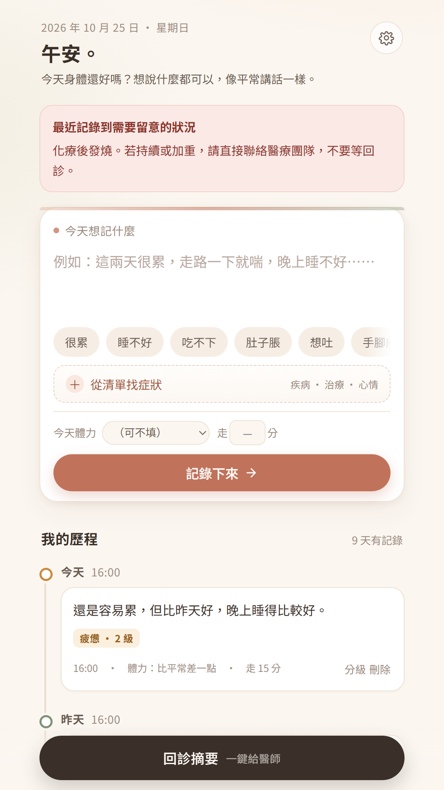
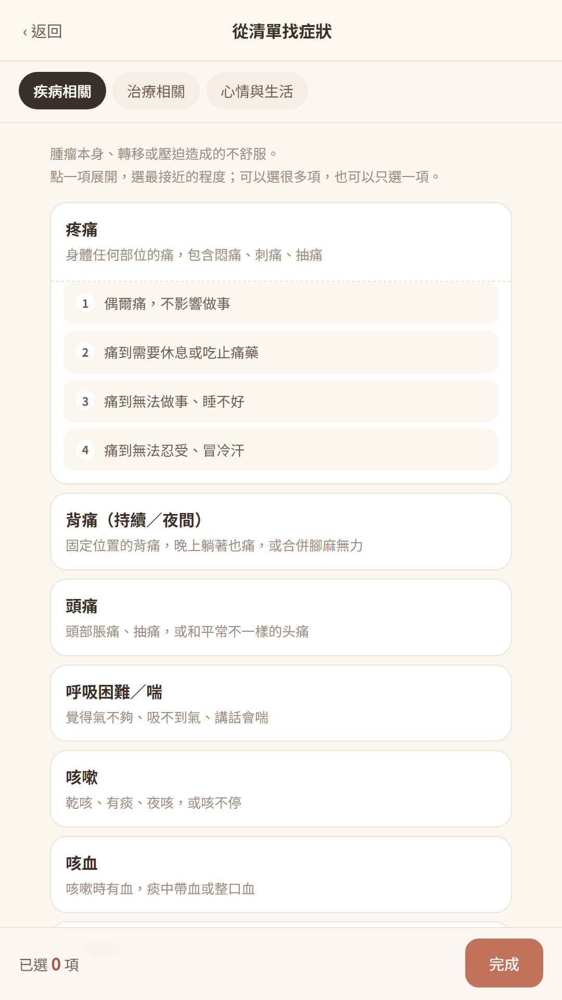
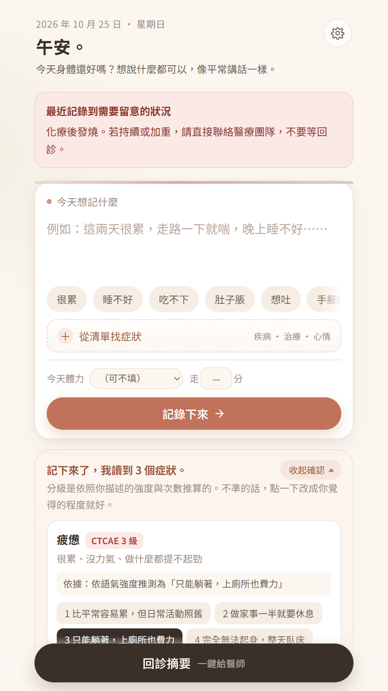
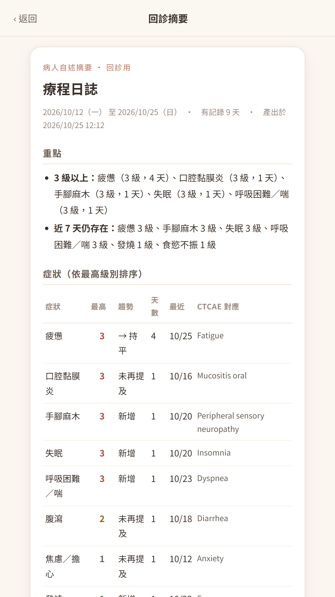

# 療程日誌 · 線上示範（Cancer Journey Journal — Live Demo）

給癌症病人的身體紀錄 App：用一句話記錄身體狀況，自動整理成 CTCAE 分級與症狀項目，回診時一鍵產出給醫師的一頁摘要。

**▶ 線上示範：** https://kcheung-inno.github.io/cancer-journey-journal-demo/

> 這是**體驗版**，只收錄部分症狀與急症規則，用來展示操作流程與輸出樣貌。
> 完整知識庫與原始碼為私有，不在本 repo，也不隨示範檔散布。

---

## 這個示範可以試什麼

1. 在首頁寫一句話，例如：`這幾天很累，一天拉肚子五次，腳有一點麻`
2. 按「記錄下來」→ 看到系統判讀的症狀與分級，可自行改成你覺得的程度
3. 按「從清單找症狀」→ 三個分類、可捲動的清單，點一項展開四級描述，選一個即可記錄（不必打字）
4. 按底部「回診摘要」→ 產出醫師版摘要：紅旗與急症提示、症狀表、功能狀態、病人原話
5. 右上齒輪 → 基本資料、匯出備份、關於與授權、隱私權政策

示範資料只存在你自己的瀏覽器裡，關掉頁面不會上傳到任何地方。

## 這個示範**不**包含

| 項目 | 說明 |
|---|---|
| 完整症狀知識庫 | 示範版僅 18 個症狀（完整版 64 個、589 個同義詞、256 個分級錨點） |
| 完整急症規則 | 示範版僅 4 條（完整版 38 條，三級分流） |
| 原始碼 | 不在本 repo；本 repo 只有編譯後、壓縮過的單一檔案 |
| 情緒篩檢流程 | 完整版在偵測到相關字句時會溫和邀請填寫 PHQ-2／GAD-2 |
| Android App | 完整版可打包為 Google Play 上架版本 |

## 關於隱私

示範頁沒有伺服器、沒有帳號、沒有分析或廣告 SDK。所有輸入只寫進你瀏覽器的
`localStorage`，重新整理或關閉瀏覽器資料即消失。頁面不發出任何網路請求。

## 重要聲明

本 App 是**記錄與溝通工具，不是醫療器材**，未經 TFDA／FDA／CE 查驗登記，
不提供診斷、治療或處置建議，不能取代醫療專業人員的判斷。

分級與提示為規則比對的輔助結果，**可能遺漏或誤判**；未出現提示不代表沒有
急症。任何時候覺得不對勁，請直接聯絡你的醫療團隊或就醫。緊急狀況請撥 119。
心理支持：1925 安心專線、1995 生命線、1980 張老師。

完整聲明見 [`DISCLAIMER.md`](DISCLAIMER.md)。

## 授權

本 repo 與其中的示範檔為 **Ken Cheung 之著作，保留一切權利**（專有授權）。
僅供瀏覽與評估使用；不得複製、修改、再散布或用於商業或臨床用途。
詳見 [`LICENSE`](LICENSE)。

## 臨床內容來源

- CTCAE v5.0（U.S. National Cancer Institute）— 引用分級概念與 adverse event 名稱
- PRO-CTCAE（U.S. NCI）— 借用「症狀＋屬性」的提問結構
- PHQ-2／GAD-2（Kroenke、Spitzer 等）— 概念引用，中文改寫
- ECOG performance status（Oken, 1982）— 由自評活動量推估

本專案與 NCI、Pfizer、Google 均無隸屬或背書關係。

## 想取得完整版

完整版（含完整知識庫、38 條急症規則、情緒篩檢、Android 打包設定、
臨床內容規格與授權文件）為私有 repo，採授權方式提供給醫療機構與研究單位。

聯絡：**Ken Cheung** · GitHub [@kcheung-inno](https://github.com/kcheung-inno)

---

© 2026 Ken Cheung. All rights reserved.
